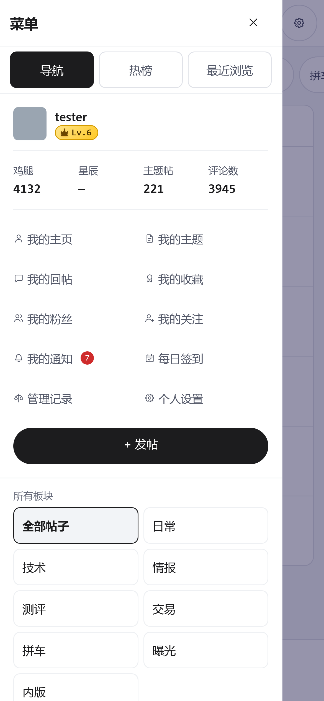

# NodeSeek Max

为 **NodeSeek / DeepFlood** 提供统一主题、阅读与回复增强。支持电脑浏览器，也适配 **iPhone Safari + Userscripts**；发帖和回复仍由论坛原生表单提交。

[](https://github.com/Ethan2258/Nodeseek-max/actions/workflows/ci.yml)
[](https://github.com/Ethan2258/Nodeseek-max/releases/latest)

**[安装 / 更新脚本](https://raw.githubusercontent.com/Ethan2258/Nodeseek-max/main/nodeseek-max.user.js)** · [安装帮助](docs/installation.md) · [使用与设置](docs/usage.md) · [更新日志](CHANGELOG.md) · [参与开发](CONTRIBUTING.md)

## 安装

1. 电脑安装 Tampermonkey 或 Violentmonkey；iPhone Safari 使用 Userscripts。
2. 打开上面的 **安装 / 更新脚本** 链接，在脚本管理器中确认安装。
3. 停用其他功能重复的 NodeSeek 增强脚本，刷新论坛页面。

**iPhone 用户**：打开安装链接后，还需要在 Safari 的扩展菜单中打开 **Userscripts**，确认安装或更新，再刷新页面。[详细步骤与常见问题 →](docs/installation.md#iphone-safari--userscripts)

## 装好后怎么用

- 顶栏 **齿轮** 打开脚本设置。改动自动保存，保存完成后点“刷新应用设置”。
- 手机左上角 **菜单** 集中提供个人入口、版块导航、热榜和最近浏览；点遮罩或关闭按钮返回正文。
- 帖子下方可切换格式工具、附件、表情和预览；回复某层时，输入框会移到对应楼层下方。

## 主要功能

| 场景 | 提供的功能 |
| --- | --- |
| 阅读 | sb.sb 风格主题、深浅色、字号与字体、代码复制、图片预览、引用折叠 |
| 列表 | 版块导航、精华 / 抽奖入口、帖子页码、屏蔽关键词与用户、我的回复标记 |
| 回复与发帖 | Markdown、附件与图片上传、表情、预览、草稿、快捷键 |
| 个人与通知 | 个人主页统计、关注 / 粉丝页、用户备注、通知与私信、黑名单通知过滤 |
| 侧栏 | 个人资料、今日热门、最近浏览；手机在菜单内切换查看 |
| 设置 | 六个分类、搜索、导入导出、恢复默认、清缓存、更新检查 |

鼠标悬停预览与预取仅在有鼠标的设备上启用。手机优先使用点按；额外请求受缓存、并发和限流控制。[功能说明与数据保存方式 →](docs/usage.md)

## 界面预览

<details>
<summary>展开电脑和手机截图</summary>

| 电脑首页 | 深色帖子 |
| --- | --- |
|  |  |
| 手机菜单 | 手机热榜 |
|  |  |

截图来自本地模拟页面；头像和内容是测试数据。

</details>

## 开发

使用 Node.js 24，先运行 `npm ci`，再运行 `npx playwright install chromium webkit`。

```bash
npm run build       # 更新主题、界面运行时和 meta
npm run check       # 仓库、语法、文档链接与生成文件一致性
npm test            # 完整浏览器回归
```

[开发指南](docs/development.md) 包含目录说明、修改入口、专项测试、截图、性能比较和发布流程；[上游维护说明](upstream/README.md) 介绍基线与合并方法。

## 许可证

[GPL-3.0-only](LICENSE)。基于 NodeSeek++ 等开源组件，来源与第三方声明保留在脚本头部和 [upstream](upstream/README.md) 中。
