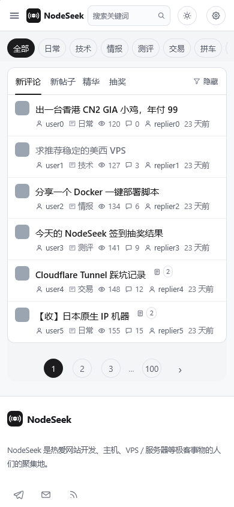
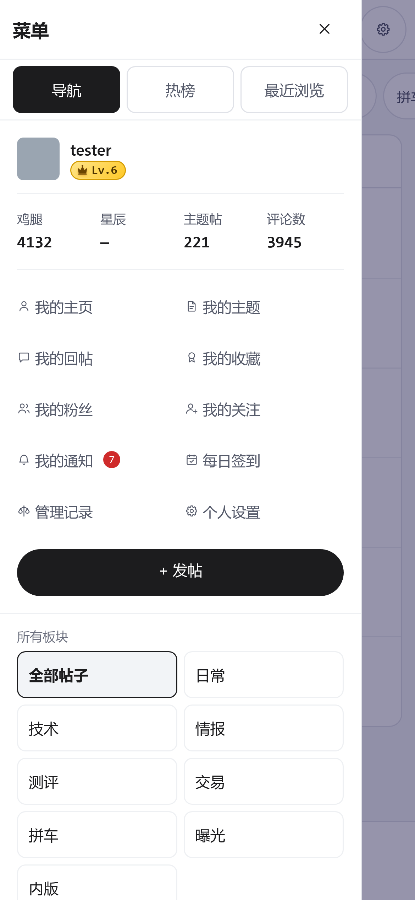
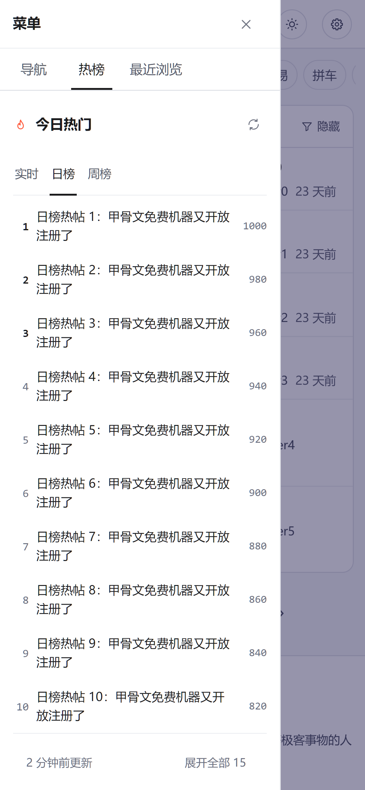
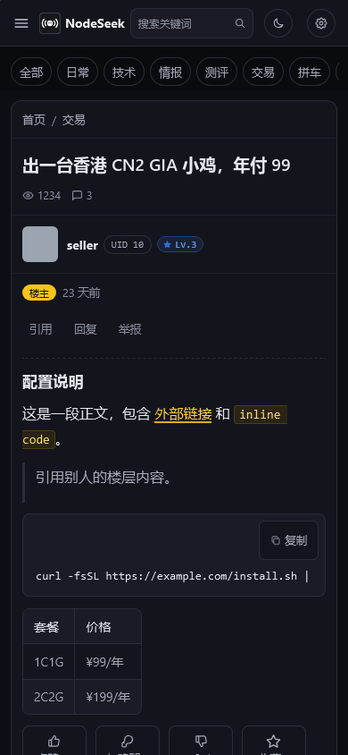
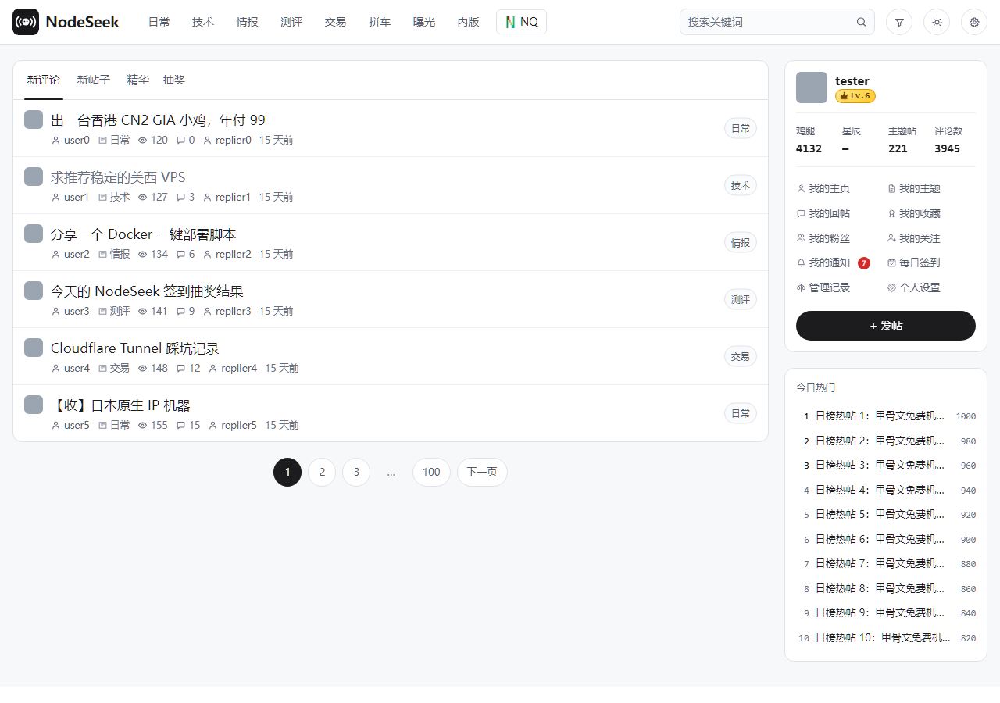
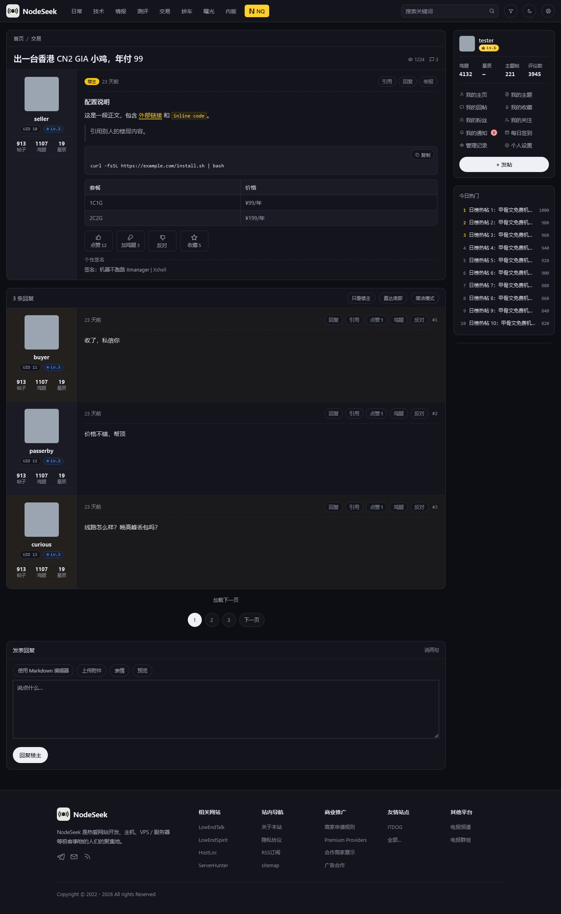
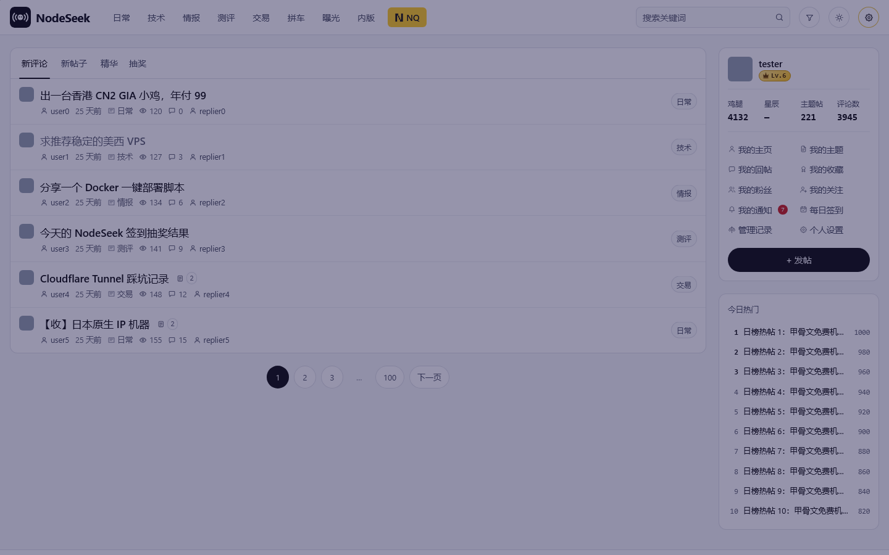
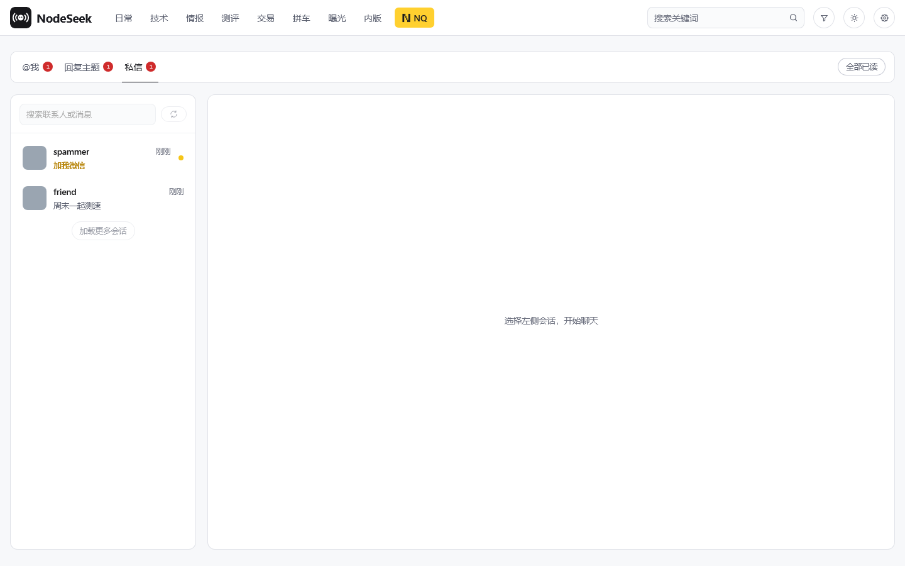

# NodeSeek Max

让 **NodeSeek / DeepFlood** 更好读、更好用的浏览器用户脚本。统一深浅色主题，整理帖子、回复和通知，也适配 **iPhone Safari + Userscripts**。

[](https://github.com/Ethan2258/Nodeseek-max/actions/workflows/ci.yml)
[](https://github.com/Ethan2258/Nodeseek-max/releases/latest)
[](LICENSE)

**[安装 / 更新脚本 →](https://github.com/Ethan2258/Nodeseek-max/releases/latest/download/nodeseek-max.user.js)**

[安装帮助](docs/installation.md) · [使用与设置](docs/usage.md) · [更新日志](CHANGELOG.md) · [反馈问题](https://github.com/Ethan2258/Nodeseek-max/issues/new/choose)

## 三步开始

1. **安装脚本管理器。** 电脑使用 [Tampermonkey](https://www.tampermonkey.net/) 或 [Violentmonkey](https://violentmonkey.github.io/)；iPhone Safari 使用 [Userscripts](https://github.com/quoid/userscripts)。
2. **[安装 NodeSeek Max](https://github.com/Ethan2258/Nodeseek-max/releases/latest/download/nodeseek-max.user.js)。** 在管理器中确认；iPhone 需打开 Safari 扩展菜单 → Userscripts，确认安装或更新。
3. **刷新论坛。** 停用功能重叠的增强脚本后，打开 NodeSeek / DeepFlood。顶栏齿轮进入脚本设置。

安装入口始终指向最新正式版。遇到扩展权限、更新或保存问题，请看 [安装与常见问题](docs/installation.md)。

## 用起来有什么变化

- **阅读更清楚**：sb.sb 圆角风格、深浅色、字号与字体、图片预览、代码复制和长引用折叠。
- **手机更顺手**：紧凑顶栏、单列菜单，版块、个人入口、热榜和最近浏览集中在侧栏。
- **回复更方便**：Markdown、附件、表情、预览、草稿和快捷键；回复某层时，输入框移到该楼层下方。
- **列表更好找**：版块导航、精华与抽奖入口、帖子页码、关键词和用户屏蔽、已回复与抽奖已参与标记。
- **个人与通知**：用户备注、活跃度标签、个人主页统计、关注与粉丝、私信和黑名单通知过滤。

设置按外观、浏览、用户、工具、网络、关于分类，可搜索、导入导出。改动自动保存，保存完成后点“刷新应用设置”。[查看功能与数据保存方式 →](docs/usage.md)

发帖、回复和评论管理沿用论坛原生权限与提交流程。悬停预览和悬停预取用于有鼠标的设备；触屏使用点按。

## 看看界面

**手机首页**



<details>
<summary>展开手机菜单、热榜与深色帖子</summary>

**手机菜单**



**手机热榜**



**深色帖子**



</details>

<details>
<summary>展开电脑首页、帖子、设置与消息</summary>

**首页**



**深色帖子**



**设置**



**消息**



</details>

截图来自本地模拟页面，头像和内容为测试数据。手机回归使用 WebKit 与触屏模拟，具体体验仍与设备、Safari 和脚本管理器版本有关。

## 反馈与参与

- 功能失效、错位或手机问题：[提交问题反馈](https://github.com/Ethan2258/Nodeseek-max/issues/new?template=bug_report.yml)。请带上脚本版本、环境和复现步骤。
- 有具体改进想法：[提交功能建议](https://github.com/Ethan2258/Nodeseek-max/issues/new?template=feature_request.yml)，说明使用场景与期望行为。
- 想改代码：[贡献说明](CONTRIBUTING.md) → [开发指南](docs/development.md) → [上游维护](upstream/README.md)。

## 本地开发

推荐 **Node.js 24**（见 [.nvmrc](.nvmrc)，最低 22）。

```bash
git clone https://github.com/Ethan2258/Nodeseek-max.git
cd Nodeseek-max
npm ci
npx playwright install chromium webkit
npm run check
```

修改界面后运行 `npm run build`，再执行 `npm run check` 和相关测试；`npm test` 运行完整浏览器回归。源文件与生成文件的对应关系、专项测试和发布规则见 [开发指南](docs/development.md)。

[sb.sb 体验对照](docs/sb-sb-compatibility.md) 记录参考来源、可适配的论坛功能与性能约束。

## 许可证与来源

使用 [GPL-3.0-only](LICENSE)。基于 NodeSeek++ 等开源组件，来源、已合并基线和第三方声明见 [上游说明](upstream/README.md) 与脚本头部。
