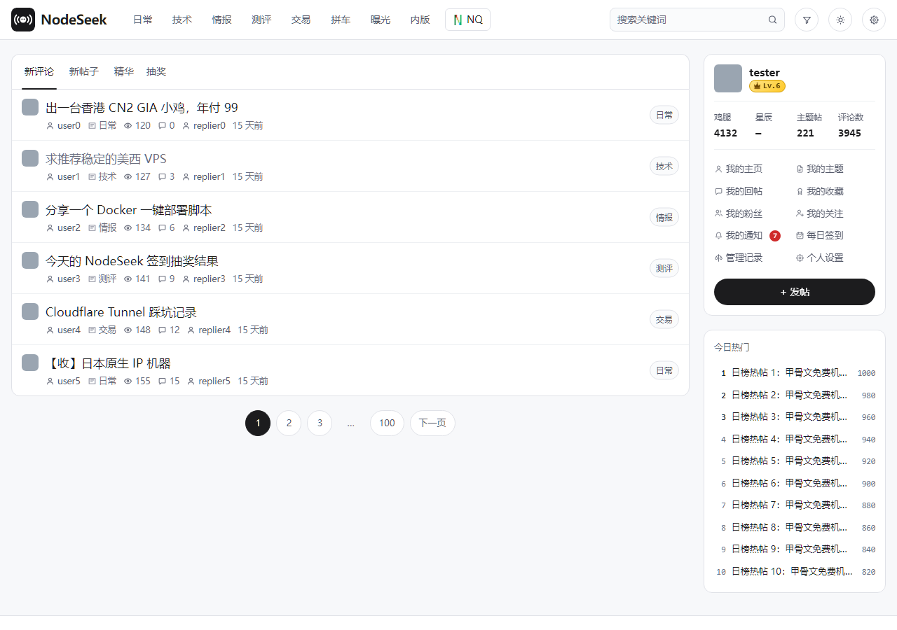
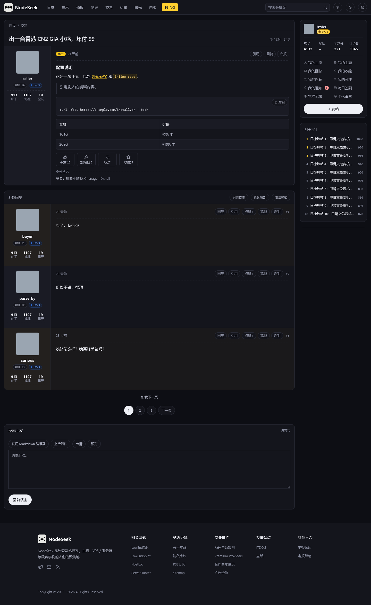
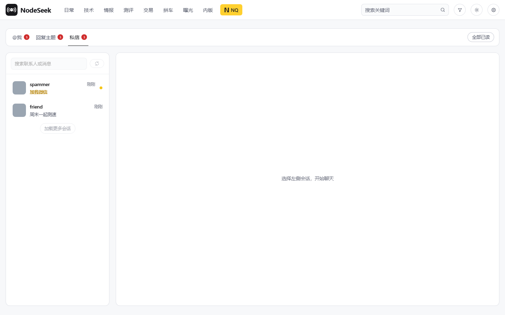
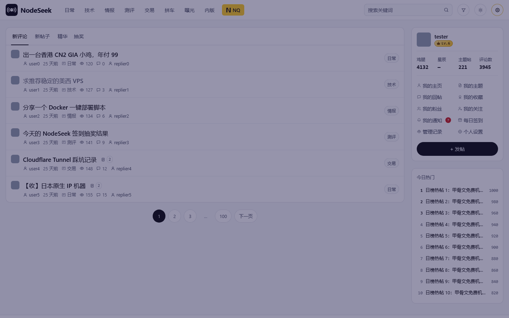

# NodeSeek Max

NodeSeek / DeepFlood 用户脚本，当前版本 **1.8.7**。界面按 [sb.sb](https://sb.sb/) 现版 1:1 复刻（配色、字体、布局、圆角），保留论坛原生编辑与提交。

## 安装

1. 安装 [Tampermonkey](https://www.tampermonkey.net/) 或 Violentmonkey。
2. [安装最新版脚本](https://raw.githubusercontent.com/Ethan2258/Nodeseek-max/main/nodeseek-max.user.js)。
3. 停用其他 NodeSeek 增强脚本，避免重复注入。
4. Tampermonkey 用户：管理面板 → 设置，「配置模式」选「高级」，把「Content Script API」改成「UserScripts API Dynamic」并保存。
   默认的注入方式要先从后台取脚本，脚本比页面晚运行，打开页面时会先闪一下站点原来的样子；改了以后脚本在页面画出来之前运行，首屏直接是整理好的完整页面。
   脚本设置「关于」里能看到当前页面是不是注入晚了。

[版本与安装文件](https://github.com/Ethan2258/Nodeseek-max/releases)

| 首页 | 帖子（深色） |
| --- | --- |
|  |  |
| **我的通知** | **脚本设置** |
|  |  |

## 当前功能

- 全站 sb.sb 样式，浅色、深色变量与 sb.sb 样式表原值一致；圆角与 sb.sb 相同（卡片 12px、输入框 8px、按钮与标签胶囊）。
- 打开快、不闪：脚本在页面画出来之前运行时，首帧整页一次画好（资料卡、列表、右栏都整理好）；站内跳转旧页面留到新页面好了才淡入切换。
  长列表只画看得见的行，整页重算样式和排版少一半左右。
- 列表工具条：新评论 / 新帖子 / 精华 / 抽奖（只收主帖有开奖链接的帖子）；顶栏版块标签和纯文字 NQ 入口。
- 右侧栏：个人资料卡（鸡腿、星辰、主题帖、评论数和十个快捷入口，我的通知带未读数）、今日热门、本机最近浏览十条，三张卡片同一帧出现。
- 帖子页照 sb.sb 经典排法：左边作者栏（头像、UID、等级、帖子 / 鸡腿 / 星辰），楼中楼收进那一层末尾，置顶回复、楼主标签、抽奖和投票卡片。
- 回复与发帖统一 sb.sb 编辑器，保留 Markdown、附件、表情、预览和粘贴图片（上传到论坛官方图床 NodeImage）；回复某一层时回复框挪到那一层下面，提交仍由原站处理。
- 帖子页回复区标题栏有「只看楼主」「直达底部」「简洁模式」；评论可自动接下一页，帖子列表默认不自动翻页。
- 我的回复：列表和帖子里标出自己回复过的楼层（#4 #22 #32），点了直接跳过去。
- 头像悬停资料卡：等级、鸡腿、星辰、主题与评论数、关注与粉丝、注册时长；可直接关注、私信、看主页、看管理记录、屏蔽（连站点黑名单）。
- 我的通知：@我 / 回复主题 / 私信一张标签栏，通知整列显示、点一行直接打开那一楼；私信左右两栏。
- 保留外链直达、关键词与用户屏蔽、黑名单通知过滤、代码复制、用户备注；各种提示统一成 sb.sb 屏幕下方的深色小条。
- 深浅色支持浅色、深色、跟随系统和跟随站点；跟随系统只响应操作系统主题。
- 脚本设置按 sb.sb 重做：外观、浏览、用户、工具、网络、关于六个分页，支持搜索、恢复默认、清空缓存、导入导出配置和检查更新，改动立即保存。

移除信用分、信任分、旧阅读历史模块、帖子监控、回帖足迹（由「我的回复」代替）、本地好友、重复资料卡及旧工具条。默认字体与 sb.sb 相同：系统字体 + Space Mono 数字（首次在线下载后缓存）；不想联网下载可在设置里改为「系统字体」。

## 开发

```bash
npm install --no-package-lock
npm run sb           # 编译套件、适配样式和界面桥接
npm run meta
npm run check
npm test
npm run screenshots  # 桌面浅色、深色与手机布局
npm run performance  # 与 v1.7.2 比较本地 fixture，三次中位数
```

测试需要 Chromium；可通过 `NSMAX_CHROMIUM` 指向已有 Chrome。sb.sb 1:1 复刻层在 `theme/design.css`（最后注入、优先级最高）；`theme/sb-suite.css` 只作对照快照，不再整份注入；适配在 `theme/sb-adapter.css`，回复与分页桥接在 `theme/ui-runtime.js`，消息与关于弹窗样式在 `theme/messages.css`、`theme/settings.css`。

浏览器回归使用真实结构的本地模拟页面；耗时数据不能代表论坛服务器或用户网络速度。原生接口、验证码和权限由站点处理。

## 许可证

GPL-3.0-only，见 [LICENSE](LICENSE)。基于 NodeSeek++ 等开源组件，第三方许可证声明保留在脚本头部。
